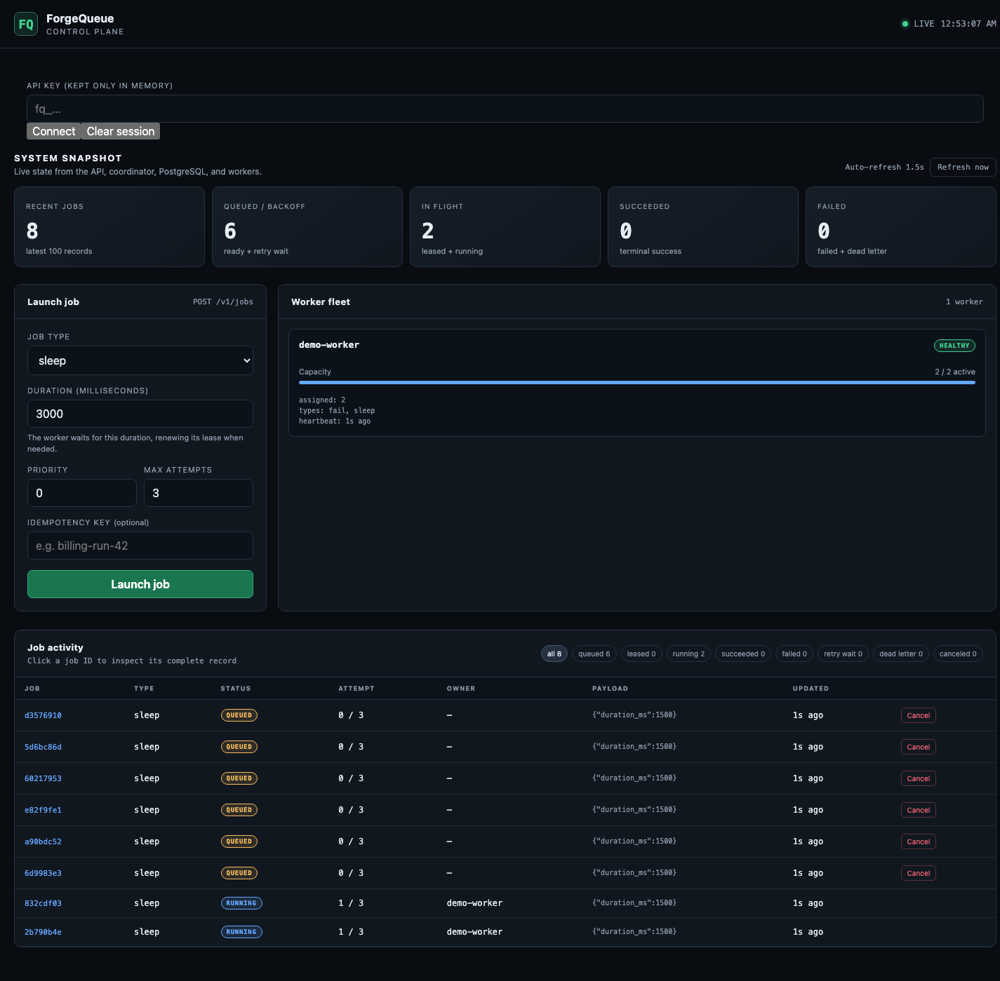
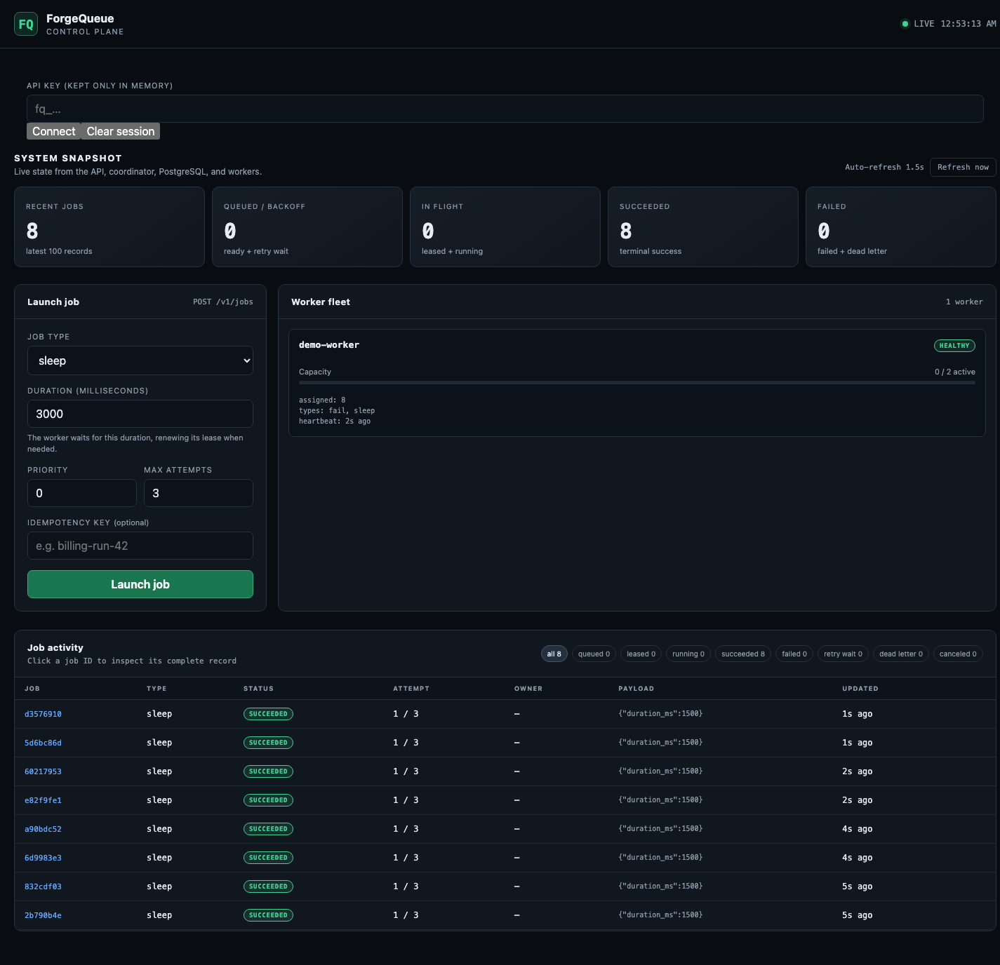

# Small live demo

This demo shows actual API/coordinator/worker processes backed by fresh disposable
PostgreSQL and Redis. It uses one worker with **two slots** and eight 1.5-second
sleep jobs. It is a correctness/visual demo, not a throughput benchmark.

## Reproduce the recorded capture

Requirements: Go, Docker Compose, Node 22+ with built-in WebSocket, and Chrome.
The default browser path is macOS Google Chrome. On another host, set
`CHROME_PATH` to an installed Chrome/Chromium executable; do not disable its
sandbox. No npm dependencies, browser extensions, or personal browser profile
are used.

```sh
GOMAXPROCS=2 FORGEQUEUE_CAPTURE_DEMO=1 make test-recovery
```

The runner chooses isolated ports and a unique Compose project. It starts the
actual service binaries, creates a disposable operator tenant, authenticates the
real dashboard, submits eight jobs through HTTP, captures active and completed
states, and asserts all jobs succeeded. It then runs the rest of the recovery,
security, and operations suite. The key is passed through process environment,
never command-line arguments, screenshots, or committed evidence. The browser
input is cleared after connection and the capture checks it is empty.

Output is under `artifacts/recovery/forgequeue-recovery-<timestamp>-<pid>/`:
`dashboard-active.png`, `dashboard-completed.png`, `demo.json`, `tests.txt`, and
`environment.txt`. The runner removes its containers, volume, temporary binaries,
and isolated browser profile; it does not touch a development database. The
browser test is opt-in and is skipped when `FORGEQUEUE_CAPTURE_DEMO` is unset.
Do not point the recovery fixtures at a valuable database.

## Recorded walkthrough

Captured 2026-10-30 against the Wave 19 working tree based on `18fba92`, Chrome
156.0.8078.74, Node 23.7.0, macOS, and the resource-limited recovery stack. Exact
browser/version/timestamp data is in [demo metadata](../artifacts/recovery/forgequeue-recovery-1793335960-80779/demo.json).

1. An operator connects with a tenant key; the field clears and the dashboard
   shows `LIVE` plus a healthy `demo-worker`.
2. Eight sleep jobs are submitted. The worker runs two while six remain queued.
   This demonstrates bounded concurrency, not eight parallel worker executions.
3. As slots free, queued jobs run. All eight reach `succeeded`; the worker returns
   to zero active jobs with eight assignments.





These images are unmodified browser captures, not generated mockups. The form's
default duration remains 3000ms; the captured API-submitted rows accurately show
their 1500ms payloads. No credential appears in either image.

## Interactive five-minute tour

Use a fresh local installation from [the operations runbook](operations.md#fresh-installation)
with one worker/concurrency two. Ensure its fixed ports are free; do not stop an
unrelated stack to make room without checking ownership. Kafka and monitoring
are not needed to run this tour.

1. Open `http://localhost:8080/dashboard`, paste an operator API key, and Connect.
2. Launch several `sleep` jobs with duration 3000ms. Watch queue and active counts,
   then click a job ID to inspect its payload, status, attempt, and result.
3. Cancel a still-queued job. Running jobs cannot be canceled through this API.
4. Launch `fail` with one failure before success and max attempts 3. Observe
   `retry_wait` and eventual success. Increase failures above max attempts to
   demonstrate `dead_letter`; use Retry only after considering side effects.
5. Reuse a submission idempotency key and confirm it returns the original job.
   This does not prove external effects are exactly once.
6. Clear session. A regular tenant key can manage its own jobs but cannot inspect
   the global fleet. Use the automated security tests for cross-tenant evidence.

Optional: start Prometheus/Grafana with their dedicated credentials and inspect
queue age, worker health, and retry counters. Optional Kafka exposes lifecycle
events via the outbox; it is not on the execution path. See [event stream](event-stream.md).

## Verification and boundaries

The capture-enabled run passed **143 top-level tests**, with no failures or skips;
the browser demo took 13.92 seconds. [Raw test output](../artifacts/recovery/forgequeue-recovery-1793335960-80779/tests.txt)
and [environment](../artifacts/recovery/forgequeue-recovery-1793335960-80779/environment.txt)
are retained. Both screenshots were visually inspected. `go vet ./...` and
JavaScript syntax checks passed. Historical k6 P99 values were checked against
their retained JSON summaries; no large benchmark was rerun.

No uptime, production capacity, cross-region recovery, or universal exactly-once
guarantee is implied. The implementation's limits and remaining product work are
listed in [architecture](architecture.md#evidence-and-limits).
